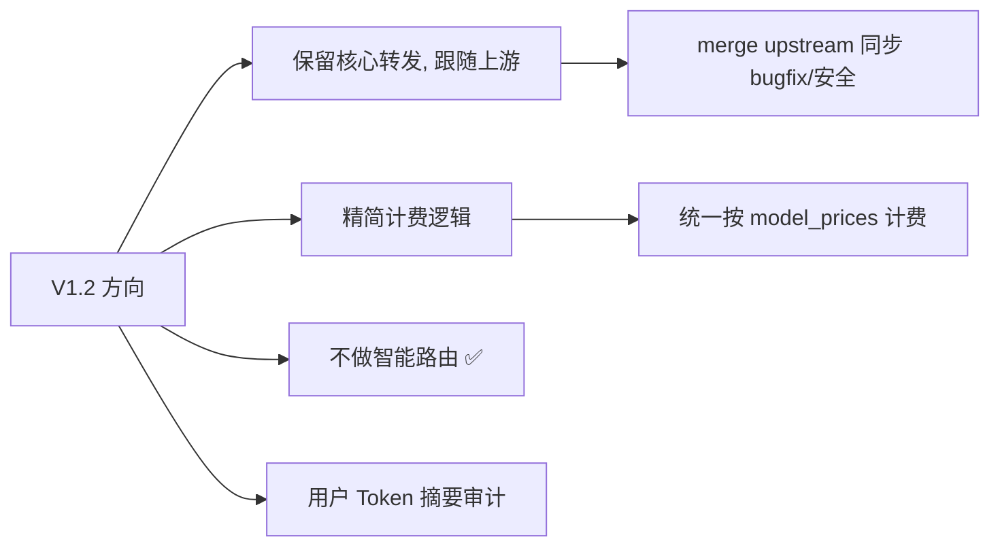
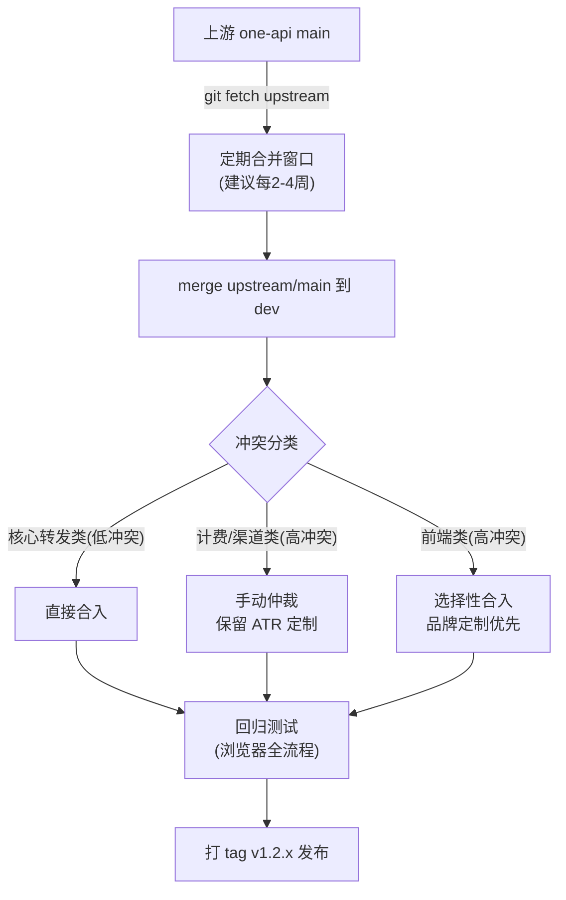
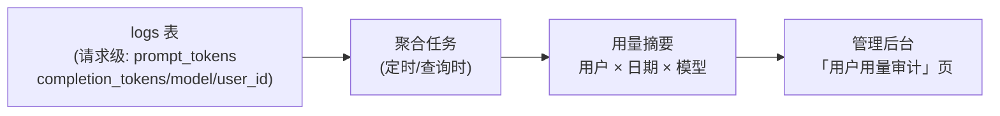
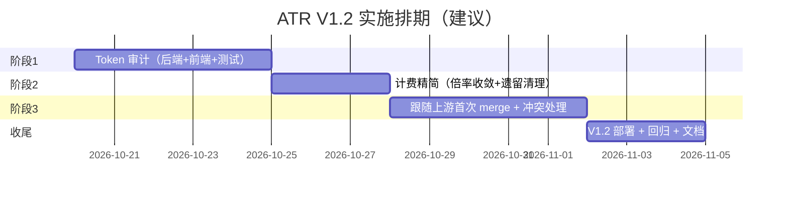

# Asterisk Token Router — V1.2 技术设计说明书

> **基于项目**: One API (songquanpeng/one-api, MIT)
> **上游基线**: `8df4a26` (2026-08-29 fetch upstream/main)
> **版本**: v1.0
> **日期**: 2026-10-20 18:40
> **状态**: 阶段 0（上游 diff 分析 + 定制点清单）交付物
> **关联**: [REQUIREMENTS.md](REQUIREMENTS.md) v2.4 第 10 章（V1.2 方向）

---

## 📋 修订历史

| 版本 | 日期 | 说明 |
|------|------|------|
| v1.0 | 2026-10-20 | 初版：定制点全景分析 + V1.2 技术设计（跟随上游/计费精简/token 审计） |

---

## 1. 概述

### 1.1 V1.2 方向（已与用户确认）



1. **保留核心**：token 转发（负载均衡、健康检查、OpenAI 兼容 API）跟随 One API 上游更新
2. **深度定制保留**：渠道组、金额制计费、健康探测、帮助页等 ATR 特有业务继续自研
3. **精简**：移除 One API 复杂倍率计费链路与遗留业务（赠送/邀请/兑换码）
4. **排除**：智能 token 路由（内容分类路由）
5. **新增**：用户 Token 摘要审计（用户×日期×模型）

### 1.2 分析基线数据

| 指标 | 数值 |
|------|------|
| 上游基线 commit | `8df4a26`（上游最新） |
| ATR 定制 commit 数 | **175** |
| 定制文件数 | **136**（+15007 / -1793 行） |
| 定制代码目录 | common / controller / middleware / model / relay / router / main.go |
| 定制前端目录 | web/（36 文件） |
| 定制文档 | docs/（43 文件） |

### 1.3 定制量评估

定制面广（136 文件、15000+ 行新增），其中**代码层约 55 文件**。跟随上游的合并冲突面集中在：

- `model/channel.go`、`model/token.go`、`model/user.go`（渠道组字段、GetModelPrice、月度额度）
- `common/config/config.go`、`common/quota.go`（金额制 QuotaPerUnit）
- `middleware/quota.go`、`relay/controller/helper.go`（熔断、GetModelPrice 计费）
- `controller/token.go`、`controller/channel-test.go`（健康检查）

---

## 2. 定制点分类清单

> 处置标记：🔧 **保留（深度定制）** ｜ 🔄 **随上游（核心）** ｜ ✂️ **精简/移除**

### 2.1 计费与配额体系（金额制）

| # | 定制点 | 涉及文件 | 处置 | 说明 |
|---|--------|----------|------|------|
| 1 | 金额制计费（1 配额=¥1，QuotaPerUnit=1M） | common/config.go, model/main.go | 🔧 保留 | v1.1.6+ 多次迭代：PreConsumed=0、输入×1M/显示÷1M |
| 2 | 按模型定价 GetModelPrice | model/channel.go, relay/controller/helper.go, relay/billing/ratio/model.go | 🔧 保留 | 价格来自 model_prices JSON（¥/M token），价格≤0 fallback modelRatio |
| 3 | LogQuota ¥ 显示 | common/utils.go | 🔧 保留 | 统一 `¥%.2f` ÷ 1e6，替代旧 One API「＄额度」文案 |
| 4 | 月度额度 + 额度申请审批 | model/quota_request.go, controller/quota_request.go, model/user.go | 🔧 保留 | 内部业务（quota_requests 表、审批流程） |
| 5 | 倍率链路清理 | relay/billing/ratio/model.go | ✂️ 部分移除 | modelRatio/completionRatio 残留逻辑应收敛（保留 fallback 用途） |

**跟随上游评估**：上游计费模型（groupId+ModelRatio 倍率）与 ATR 金额制冲突，**上游计费相关改动应选择性合并**（仅取 bugfix/安全补丁）。

### 2.2 渠道组与渠道管理

| # | 定制点 | 涉及文件 | 处置 | 说明 |
|---|--------|----------|------|------|
| 6 | channel_group 渠道组字段 | model/channel.go, model/ability.go | 🔧 保留 | 取代上游原 group，allowAdditions+search 打字新建 |
| 7 | 渠道禁用后过滤模型 | model/ability.go, controller/ | 🔧 保留 | JOIN channels 排除 status=2 渠道模型 |
| 8 | 渠道级熔断与计费告警 | model/alert.go, common/alert.go, common/notifier/wecom.go, common/notify.go, middleware/quota.go | 🔧 保留 | billing_type/warning_pct/breaker_pct + 企微通知 |

### 2.3 令牌管理

| # | 定制点 | 涉及文件 | 处置 | 说明 |
|---|--------|----------|------|------|
| 9 | 令牌仅管理员可见 + 我的令牌 | controller/token.go, model/token.go | 🔧 保留 | admin:true 才可见；普通用户仅 /mytoken |
| 10 | 令牌-用户/渠道组关联 | model/token.go | 🔧 保留 | token.Update 含 user_id；创建选渠道组自动填充模型 |
| 11 | 管理员创建/管理任意令牌 | controller/token.go | 🔧 保留 | role>=10 可为他人生成 |

### 2.4 用户/权限/认证

| # | 定制点 | 涉及文件 | 处置 | 说明 |
|---|--------|----------|------|------|
| 12 | ctxkey.Role 角色注入 | middleware/auth.go | 🔧 保留 | UserAuth 查 DB 后注入，管理员权限判断依赖 |
| 13 | AdminRoute 前端路由守卫 | web/ | 🔧 保留 | role>=10 校验，10 个管理员子路由 |
| 14 | 登录页精简 + 按角色跳转 | controller/user.go, web/ | 🔧 保留 | 无注册/忘记密码；root 按角色跳 dashboard |
| 15 | 用户自助修改密码 | controller/user.go | 🔧 保留 | 内部使用无需邀请链路 |
| 16 | SESSION_SECRET 环境变量 | common/init.go, main.go | 🔧 保留 | 防重启掉线（随上游 merge 时需保留） |

### 2.5 健康检查（核心增强）

| # | 定制点 | 涉及文件 | 处置 | 说明 |
|---|--------|----------|------|------|
| 17 | chat completions 探测 | model/health_checker.go, controller/channel-test.go | 🔧 保留 | ping+max_tokens=1；接受 2xx-4xx 为存活 |
| 18 | 详细健康日志 | model/health_checker.go | 🔧 保留 | 空 base_url/HTTP 状态/尾部模型 |

### 2.6 前端与帮助页

| # | 定制点 | 涉及文件 | 处置 | 说明 |
|---|--------|----------|------|------|
| 19 | 品牌化前端（ESG/ATR 风格） | web/ (36 files) | 🔧 保留 | 品牌名称/页脚/版本弹窗 |
| 20 | 帮助页（SemanticUI 真实组件） | web/ | 🔧 保留 | 5 卡片：登录/mytoken/API/额度/端点；数据来自页面快照 |
| 21 | 仪表盘按角色区分 | web/ | 🔧 保留 | 管理员/普通用户不同视图 |
| 22 | 三组件：AddUser≠EditUser≠MyToken | web/ | 🔧 保留 | 组件同名陷阱（isAdmin 显式导入） |

### 2.7 部署/构建/CI

| # | 定制点 | 涉及文件 | 处置 | 说明 |
|---|--------|----------|------|------|
| 23 | build.sh 三步 temp 复制 + go:embed | scripts/build.sh, main.go | 🔧 保留 | web/build/default 路径；embed 递归 |
| 24 | 版本号 A.B.C build MMdd.HHMM | VERSION, scripts/build.sh | 🔧 保留 | VERSION 文件管理主版本 |
| 25 | CI 适配（web/build 占位、go 1.22、image 网络跳过） | .github/workflows/ci.yml, common/image/image_test.go | 🔧 保留 | commit subject 全小写过 commit_lint |
| 26 | 禁用上游 Docker/Release 自动触发 | .github/ | 🔧 保留 | 无凭证环境 |

### 2.8 智能路由（废弃）

| # | 定制点 | 涉及文件 | 处置 | 说明 |
|---|--------|----------|------|------|
| 27 | 内容分类器 | middleware/content_classifier.go | ✂️ **移除** | V1.2 明确不做智能路由 |
| 28 | auto 路由映射 | middleware/auto_router.go, middleware/distributor.go | ✂️ 简化 | auto 一律路由默认模型（保留，删分类逻辑） |
| 29 | auto 路由 body 改写 | middleware/distributor.go | ✂️ 收敛 | 保持默认模型透传 |

### 2.9 品牌资产与许可

| # | 定制点 | 涉及文件 | 处置 | 说明 |
|---|--------|----------|------|------|
| 30 | LICENSE Apache 2.0 + NOTICE | LICENSE, NOTICE | 🔧 保留 | 标注上游 MIT 来源 |
| 31 | ATR logo/VI 资产 | web/, sketches/ | 🔧 保留 | 品牌资产随前端 |

### 2.10 文档与测试

| 定制点 | 说明 |
|--------|------|
| REQUIREMENTS.md v2.4 | 持续演进主文档（不覆盖，版本头更新） |
| 测试文档（96 用例） | docs/ 43 文件，浏览器全流程验证 |
| 周报/验证报告 | 归档 docs/ |

---

## 3. V1.2 技术设计

### 3.1 跟随上游策略（§REQUIREMENTS 10.1）



**冲突预判**（按 §2 清单）：

| 冲突等级 | 模块 | 处理 |
|----------|------|------|
| 低 | 核心 relay 转发、模型 misc、健康检查 | 直接 merge，小冲突手工解 |
| 中 | token/ability 表层字段 | 保留 ATR 字段，上游结构变更需映射 |
| 高 | 计费（billing/ratio）、渠道（channel）、配置（config） | ATR 定制深，合并时以 ATR 为准或抽象适配层 |

**建议**：为高冲突面建立**适配层**（包装上游 model 结构 → ATR 金额制），而非直接改上游代码，降低未来 merge 成本。

### 3.2 计费精简设计（§REQUIREMENTS 10.2）

**现状**：`relay/controller/helper.go` 已用 `channel.GetModelPrice()`（按模型定价），但 `relay/billing/ratio/model.go` 仍保留 modelRatio 倍率链路（作为价格≤0 的 fallback）。

**目标**：

1. **唯一计费口径**：`quota = promptTokens×inputPrice/1e6 + completionTokens×outputPrice/1e6`（内部单位，×1e6 取整）
2. **移除**：modelRatio×groupRatio×completionRatio 主链路（仅保留 modelRatio 作为未配置价格时的 fallback，验证价 ≤0 场景）
3. **清理遗留**：赠送/邀请/兑换码业务（`model/user.go` 注册日志已改「新增用户」，其余遗留同步清理）
4. **DB options**：`QuotaForNewUser/QuotaPerUnit` 按金额制固定值管理

### 3.3 用户 Token 摘要审计设计（§REQUIREMENTS 10.4）



**数据模型**：

```
usage_summary 表（新建）
├── user_id      FK → users.id
├── date         DATE（按天聚合）
├── model_name   VARCHAR（模型名）
├── request_count INT
├── prompt_tokens BIGINT
├── completion_tokens BIGINT
├── total_tokens BIGINT
├── quota_cost   BIGINT（内部单位，可选）
└── UNIQUE(user_id, date, model_name)
```

**实现路径**：

| 步骤 | 内容 | 文件 |
|------|------|------|
| 1 | 新建 usage_summary 表（migration） | migrations/ |
| 2 | 日志写入时同步累加（或定时聚合 logs） | model/log.go, controller/ |
| 3 | 聚合查询 API：`GET /api/usage-summary?user_id=&start=&end=` | controller/, router/api.go |
| 4 | 管理后台审计页面（表格+汇总+筛选） | web/ |

**设计决策**：优先**查询时聚合 logs**（数据量可接受时不建冗余表），量大后再落 usage_summary 表（定时任务）。

### 3.4 不做智能路由（§REQUIREMENTS 10.3 ✅）

- 保留 `distributor.go` 的 `auto`/空值 → 默认模型透传
- 删除 content_classifier 调用链（或保留文件但不再接入路由）
- 不扩展分组差异化路由、可配置映射

---

## 4. 实施建议



| 阶段 | 内容 | 依赖 |
|------|------|------|
| 1 | 用户 Token 摘要审计（§3.3） | 无（独立增量） |
| 2 | 计费精简（§3.2） | 无 |
| 3 | 跟随上游 merge（§3.1）+ 智能路由清理（§3.4） | 阶段 1/2 合入后 |
| 收尾 | 全量回归（96 用例）+ VERSION bump + tag v1.2.0 | 全部 |

**建议起步**：阶段 1（token 审计）——改动可控、需求明确、不依赖其他架构决策。

---

## 5. 风险与注意事项

| 风险 | 等级 | 缓解 |
|------|------|------|
| 上游演进快，merge 冲突多（计费/渠道） | 高 | 适配层抽象；定制点收敛独立文件；定期（2-4 周）合并而非大积压 |
| 金额制与上游计费模型冲突 | 高 | 计费逻辑独立模块，上游改动走适配 |
| 前端 36 文件定制，上游重构冲突 | 中 | 前端尽量模块级跟随；冲突高发区（令牌/渠道表单）以 ATR 为准 |
| 跟随上游带来行为回归 | 中 | 浏览器全流程回归（96 用例）+ CI 门禁 |
| .DS_Store/误提交二进制 | 低 | .gitignore 已加固（`**/.DS_Store`） |

---

## 6. 附：定制 commit 索引（175 commits）

> 完整清单见 `git log --oneline 8df4a26..HEAD`（dev-v1.1.0 分支）。按主题抽样：

| 主题 | 代表作 |
|------|--------|
| 初始 fork | 690fe28 Initial commit；74f6071 merge 上游 |
| 金额制计费 | 01384ed/424167d/b8467f8（QuotaPerUnit=1M）；447d60c/9f538d9（GetModelPrice） |
| 渠道组 | 17d8591/4af75ee/fc7c9b2（channel_group 取代 group） |
| 令牌管理 | 46331b1/6362288/07d9bca（v1.1.0 令牌重构） |
| 权限 | 8491c31（ctxkey.Role）；63894aa/abb721a（AdminRoute） |
| 健康检查 | 3461ab1/339c2ea（chat completions 探测） |
| 帮助页 | 80b0480/87570cb（SemanticUI 真实组件） |
| 部署/CI | 120428b/ca45fe5（build.sh）；7c29eab（web/build 占位） |
| 智能路由 | 5a91c11/f766f3b（auto 路由）→ V1.2 废弃 |
| 品牌 | cd70ae6/84d0ad3（ATR 品牌 + logo） |